<h1 align="center">KnulliPod</h1>

<p align="center">
  <b>An iPod-style music player for Anbernic handhelds running Knulli.</b><br>
  The iPod classic interface, rebuilt natively from <a href="https://github.com/tvillarete/ipod-classic-js">iPod.js</a>.<br>
  Split-screen menus, Cover Flow, a 3D Now Playing screen, wheel-keyboard search and games.<br>
  Your own music, lossless and hi-res, played at its native sample rate.
</p>

<p align="center">
  <a href="https://github.com/stefanobuttarelli/knullipod/raw/main/release/knullipod-v0.31.1-knulli.zip"><b>Download v0.31.1</b></a> ·
  <a href="#installation">Install</a> ·
  <a href="#controls">Controls</a> ·
  <a href="#building-from-source">Build</a> ·
  <a href="CHANGELOG.md">Changelog</a>
</p>

<p align="center">
  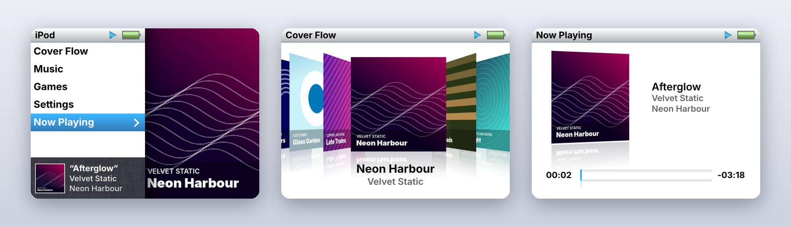
</p>

---

## Features

- **The iPod classic interface, faithfully.** KnulliPod redraws iPod.js natively at 640×480:
  - split-screen menus with live previews and a Ken Burns pan over the album art;
  - the list styles and the slide transitions.

  Sizes, colours, icons and animation timings come from the original code.
- **Cover Flow.** Flick through your albums in 3D with reflections. Flip a cover to see its tracks, with their lengths and a scrollbar, and play one straight from the back.
- **Now Playing while you browse.** While music plays, the menus show the cover, song, artist and album at the bottom, like on an iPod nano. Long lines scroll, a pause dims the cover, and changing song slides to the next one.
- **Now Playing.** The tilted 3D cover, a scrubber for seeking and a volume bar. Small icons show shuffle and repeat. Lossless files get a LOSSLESS badge with a small animated level meter.<br>
- **Japanese titles too.** Latin, Greek and Cyrillic come from Inter, kana and kanji from Noto Sans JP.
- **Search** with the iPod's wheel keyboard, across artists, albums, songs and playlists.
- **YouTube (optional):** turn it on in Settings → YouTube and search in Music → Search → YouTube. A video with chapters becomes an album with a track per chapter, a playlist an album with a track per video. Tracks are tagged M4A with a square cover made from the video's picture. The tools (yt-dlp, QuickJS) are downloaded from their official GitHub releases when you turn it on, checked (SHA-256 where published, CPU, a test run) and not shipped. YouTube's terms don't allow downloading: use it for your own or freely licensed videos.
- **Games:** Brick and Solitaire, the classic iPod games (Solitaire saves your game), and **Weather**: search for a place and see 10 days of forecast, with glossy animated icons in the spirit of the mid-2000s (data by [Open-Meteo](https://open-meteo.com), free, no account).
- **Audio quality:**
  - every track plays at its own sample rate (44.1, 48, 96, 192 kHz…), with 32-bit float mixing;
  - 24-bit FLAC and ALAC reach the system mixer untouched;
  - formats: FLAC, ALAC, AAC/HE-AAC (`.m4a`), WAV, AIFF, MP3 and OGG.
- **A library that handles real-world folders:**
  - albums stay whole across mixed artists, and CD1/CD2 subfolders count as one album;
  - untagged files get artist, album and track number from their folders and file names;
  - cover art comes from the file (JPEG, PNG, WebP) or from `cover.jpg` / `folder.jpg` next to it.
- **Headphones:**
  - wired and Bluetooth media buttons work, even in Hold;
  - unplugging pauses the music, like on an iPod;
  - a Bluetooth icon shows in the status bar.
- **Hold switch.** SELECT locks the controls and dims the screen while the music keeps playing.
- **Light, dark or automatic theme**, with dark from 20:00 to 7:00.
- **Missing covers found online.** Settings → Library → Missing Covers lists the albums without one: choose one to see what MusicBrainz, iTunes, Deezer and Wikipedia find (with thumbnails and the source) and pick, or search by hand; Search All Automatically fetches them from the Cover Art Archive (MusicBrainz), or else from iTunes, Deezer or Wikipedia, with the same checks. For a soundtrack ripped from a game, which has no album cover of its own, Wikipedia gives the game's box.
- **Internet Archive.** Search archive.org, see each item's license, and download albums (FLAC, ALAC, WAV, AIFF or MP3) straight into your library.
- **Updates over Wi-Fi.** KnulliPod checks this repository once a day and shows **Update Available** in the main menu; Software Update installs the new version in place.
- **Your data where you want it.** Settings → Database moves the library, artwork and settings to another folder, such as an SD card shared between consoles.

<p align="center">
  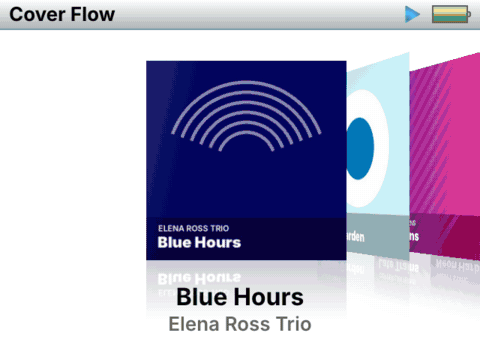
</p>

## Screenshots

| | | |
|:-:|:-:|:-:|
| 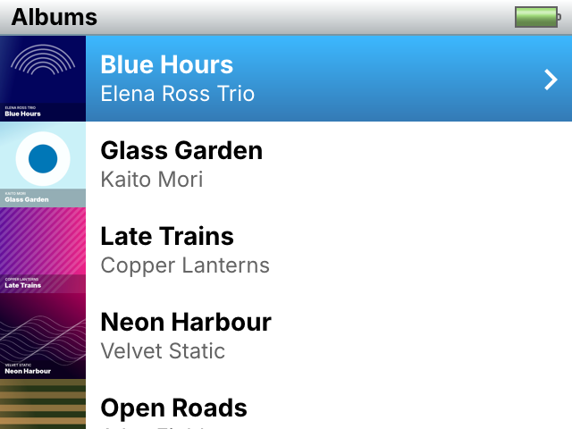<br>Albums | 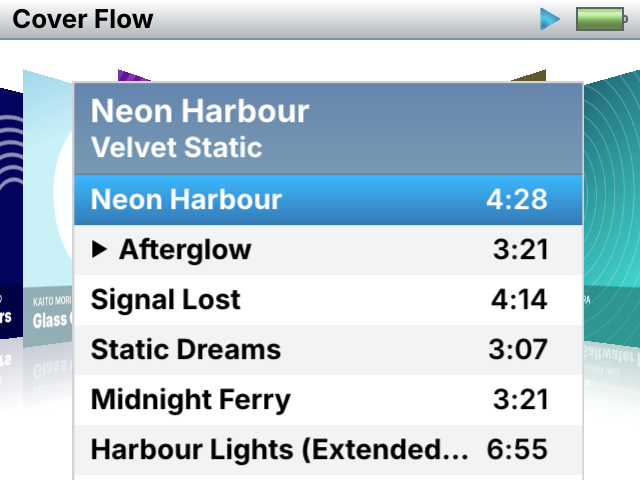<br>Cover Flow track list | 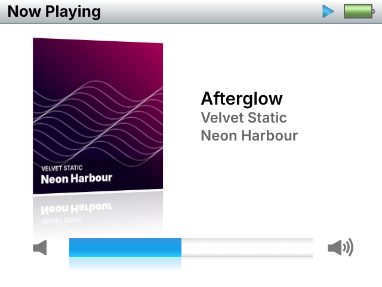<br>Now Playing, volume |
| 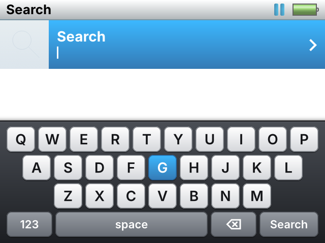<br>Search | 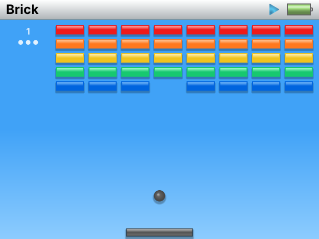<br>Brick | 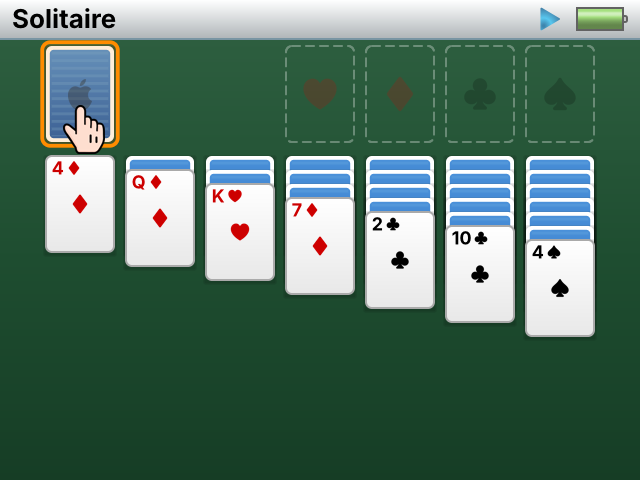<br>Solitaire |
| 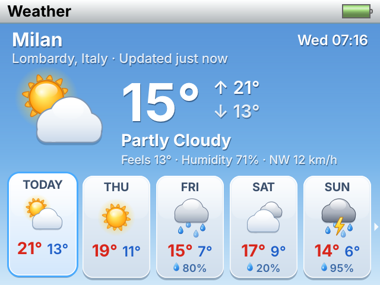<br>Weather | | |
| 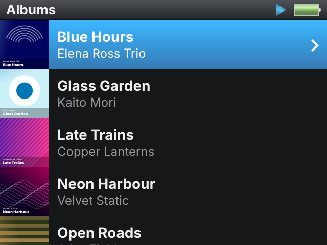<br>Dark theme | 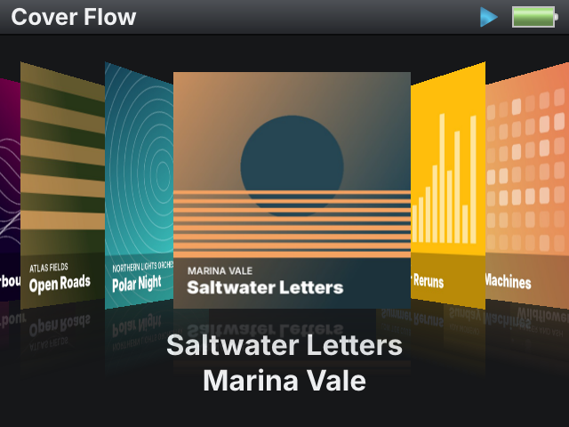<br>Cover Flow, dark | 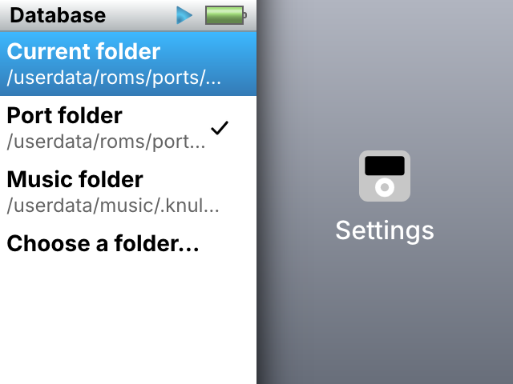<br>Settings → Database |

<sub>Screenshots are real frames from the app. The albums, artists and covers are made up for the demo.</sub>

## Requirements

- An Anbernic handheld with the Allwinner H700 (aarch64) running [Knulli](https://knulli.org).
- PortMaster-style ports enabled: KnulliPod is launched from **Ports**.
- Your music on the console (or a card), any of the formats above.

## Installation

1. Download [`knullipod-v0.31.1-knulli.zip`](https://github.com/stefanobuttarelli/knullipod/raw/main/release/knullipod-v0.31.1-knulli.zip) and unzip it.
2. Copy `KnulliPod.sh` and the `knullipod` folder to `/userdata/roms/ports/`.
3. Put your music in `/userdata/music`, the `music` share on the network.
   - `Artist/Album/` folders with tagged files work best.
   - DRM-protected `.m4a` files, such as old iTunes purchases, can't be played.
4. In EmulationStation, update the game lists and start **KnulliPod** from Ports.

The first start scans the music folder. Later starts load the saved library instantly. Settings → Library → **Rescan now** picks up new music.

## Controls

| Button | On the iPod | Action |
|---|---|---|
| D-pad or either stick | Click wheel | Down/right = forward, up/left = back; hold to keep scrolling |
| A, or a stick click | Centre button | Select; hold 0.5 s for options (Play Next / Add to End of Queue) |
| B | MENU | Back; hold 0.5 s to return to the main menu |
| START or X | Play/Pause | Play/Pause |
| L / R | ⏮ / ⏭ | Previous / next track |
| Y | | Queue the selected song or album: Play Next or Add to End of Queue (in Cover Flow too) |
| SELECT | Hold switch | Lock/unlock the controls and dim the screen; the music keeps playing |
| MENU (function key) | | Tap: screen off/on. Hold 5 s: quit |
| SELECT + START | | Quit |

- **Now Playing:**
  - Y (or holding A) opens **Up Next** (also in the Music menu), the songs that will play next: A plays one at once; Y on a song offers Play Next and Remove from Up Next; Clear Up Next empties it;
  - up/down change the volume;
  - the centre button switches to the scrubber, and then up/down seek.
- **Search keyboard:** a QWERTY grid. The keys with a shortcut show its button: X space, B delete, Y 123, START search (the magnifying glass).
  - the d-pad moves between the keys;
  - A types the selected key, B deletes, holding B closes the keyboard;
  - X types a space, Y switches to 123 (digits and symbols);
  - L / R move the cursor in the text, START searches.
- **Hold:**
  - up/down set the brightness, and KnulliPod remembers it;
  - after 5 seconds the Now Playing screen comes up, with the clock in the status bar.
- **Solitaire:**
  - the wheel moves the hand, and A picks up or drops cards;
  - holding A undoes a move, and B opens the pause menu.
- **Brick:** left/right move the paddle, and A launches the ball.
- **Weather:**
  - in the list, Search for a Place opens the keyboard; choosing a result saves the place;
  - in a forecast, the wheel or d-pad picks the day, A updates the forecast and B goes back;
  - holding A on a place removes it; Units switches between °C and °F.

## Settings

| Setting | What it does |
|---|---|
| Shuffle, Repeat | Submenus with the options; the active one is ticked |
| Theme | Light (as iPod.js), dark, or automatic (dark from 20:00 to 7:00) |
| Library | Music folder, songs/albums/artists, formats found and unsupported files, disk space, last scan, **Rescan now**, **Missing Covers** (each album's search results with thumbnails, search by hand, or all automatically), **Browse Files** (see and delete files and folders), **Scanned Folders** (every folder of the last scan with its song count, and the skipped ones with why) |
| Database | Folder for the library, artwork, settings, statistics and game saves |
| Software Update | Checks for a new version over Wi-Fi and installs it |

### Database folder

By default everything is kept in `knullipod/conf`. Settings → Database offers:

- **Port folder:** the default, `knullipod/conf`.
- **Music folder:** `/userdata/music/.knullipod`, which is hidden so the library scan skips it.
- **A `knullipod` folder** on each card or drive mounted under `/media`.
- **Choose a folder…:** browse to any folder, or create a new `knullipod` folder.

What happens depends on the folder:

- **No database there:** KnulliPod moves the current one ("Move database here").
- **A database already there**, for example from another console:
  - **Use database there** loads it as it is;
  - **Replace with current** overwrites it with this console's database.

The choice is stored in `knullipod/conf/datadir.txt`. If the folder is missing at start-up, for example because the card was removed, KnulliPod falls back to the port folder and says so on the Database screen.

### Internet Archive

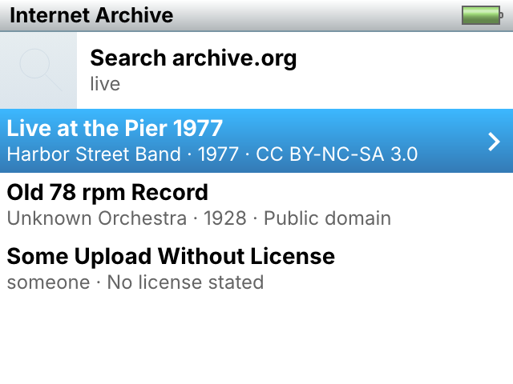

Music → Internet Archive searches [archive.org](https://archive.org) over Wi-Fi.

- **Results:** each one shows its title, creator, year and license, as archive.org records it (Creative Commons, public domain, or "No license stated"). They come 50 at a time; **More results…** loads the next page.
- **An item:** shows a download button for each format it has (FLAC, ALAC, WAV, AIFF, MP3) with its size, and the tracks; selecting a track downloads just that one.
- **Where it goes:** downloads go to `<music>/Internet Archive/<creator>/<title>/` with the item's cover. The library is rescanned when they finish.

To open an item you know, type its identifier (the part of the link after `/details/`) and choose **Open item**. This also works for items that archive.org's search doesn't list. The search is not filtered: check the license before you download, and download only what you have the right to.

### Software Update

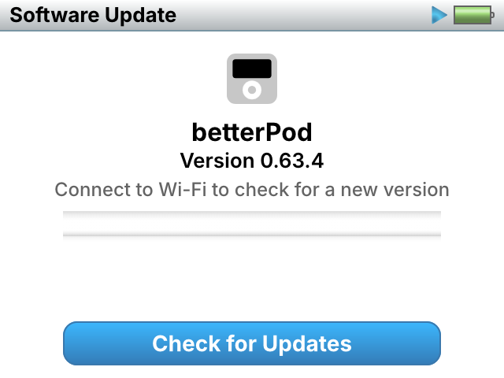

Settings → Software Update opens a full-screen page with a download bar. **Check for Updates** reads [`release/latest.json`](release/latest.json) from this repository over Wi-Fi. When a newer version is listed, the page shows what's new, and **Download and Install** does the following:

1. downloads the release zip and checks its size and SHA-256;
2. replaces the app's files one by one, keeping the previous binary as `knullipod/MiyooPod.prev`;
3. restarts KnulliPod.

KnulliPod also checks by itself once a day (30 s after start-up, when a day has passed since the last check). When a new version is out, the main menu shows **Update Available**, a shortcut to this page. Nothing is downloaded without asking.

The database (`knullipod/conf`, or the folder chosen in Settings → Database) is never touched. You can also update by hand at any time: copy the new zip over the old installation.

## Options

Advanced switches are environment variables. Uncomment them in `KnulliPod.sh`:

| Variable | Effect |
|---|---|
| `MIYOOPOD_SWAP_AB=0` | Swap A and B, if they are reversed on your device |
| `MIYOOPOD_STICK_WHEEL=1` | Turn the stick like the click wheel instead of using it as arrows (faster spin, faster scroll) |
| `MIYOOPOD_WHEEL_STEP=15` | Degrees of stick rotation per wheel step (5–90) |
| `MIYOOPOD_HOLD_BRIGHTNESS=10` | Brightness in Hold, in % (default: a fifth of the current one) |
| `MIYOOPOD_HOLD_ADJUST=0` | Up/down don't change the brightness in Hold |
| `MIYOOPOD_SOFT_VOLUME=1` | Use the app's own volume instead of the console's |
| `MIYOOPOD_MEDIA_KEYS=0` | Ignore headphone buttons |
| `MIYOOPOD_BT_ICON=0` | No Bluetooth icon and no pause on disconnect |
| `MIYOOPOD_VOLUME_KEYS=0` | Don't read the volume keys (the overlay then follows the system volume only) |
| `MIYOOPOD_AUTO_UPDATE_CHECK=0` | No automatic daily check for new versions |
| `MIYOOPOD_PERF=1` | Log frame timings every second (for reporting stutter) |
| `MIYOOPOD_VSYNC=0` | Disable vertical sync |
| `MIYOOPOD_CLASSIC_UI=1` | Use the original MiyooPod interface |

The log is written to `knullipod/miyoopod.log`.

## Building from source

You need:

- Go 1.24;
- [zig](https://ziglang.org), installed with `pip install ziglang`, used as the aarch64 C compiler with glibc 2.28;
- the SDL2 headers and `libSDL2-2.0.so` for aarch64, in a folder with `include/SDL2` and `lib/`.

`SDL2_mixer` (with the ALAC, AAC and 24-bit patches) is linked against the copy shipped in `port/knullipod/libs`.

```sh
SDL2_SYSROOT=/path/to/sysroot tools/build.sh
# -> dist/knullipod.zip   (KnulliPod.sh + knullipod/, binary: knullipod/MiyooPod)
```

The binary is built from the file list (`src/*.go`), not as a package, because `main.go` includes the C files (`main.c`, `audio.c`).

### Source layout

| Path | Contents |
|---|---|
| `src/ij_*.go` | The iPod.js interface: views, Cover Flow, Now Playing, search, sheets, games, themes |
| `src/main.c`, `src/audio.c` | SDL2 input (gamepad, stick wheel, media keys), display and vsync; SDL_mixer playback with sample-rate switching |
| `src/library.go`, `src/ij_libinfo.go` | Library scan, album grouping, artwork, scan statistics |
| `src/datadir.go`, `src/ij_datadir.go` | Database folder and Settings → Database |
| `src/ij_archive.go` | Music → Internet Archive (search, item, download) |
| `src/ij_keyboard.go` | The on-screen QWERTY keyboard |
| `src/ij_youtube.go`, `src/ij_ytdl.go` | YouTube: tools and settings; search, item page, download as albums |
| `src/ij_m4a.go`, `src/ij_ytcover.go` | M4A cutting and tagging without ffmpeg; square covers from video pictures |
| `src/ij_covers.go` | Cover search (MusicBrainz, Cover Art Archive), Search All Automatically |
| `src/ij_coversources.go` | The other cover sources: iTunes, Deezer, Wikipedia |
| `src/ij_coverpick.go` | Missing Covers: the albums without a cover, each one's results to choose from |
| `src/ij_update.go` | Settings → Software Update (manifest, download, install, restart) |
| `src/duration.go` | Track lengths read from the file headers |
| `src/knulli.go` | Knulli integration: paths, backlight, system volume, Bluetooth |
| other `src/*.go` | Player, queue, playback state and settings, inherited from MiyooPod |
| `port/` | The package: launcher, assets, fonts, bundled libraries |
| `tools/` | Build script and the tools used to recover the v0.20 sources |

## How this repository came to be

The v0.20 source tree was lost. It was rebuilt from the surviving release binary and build cache, file by file. Each function was recompiled and its machine code compared with the original v0.20 object until they matched: 978 functions identical, 53 equivalent. [docs/recovery](docs/recovery) describes the method and the result. Versions 0.21 and later build on the recovered code.

## Credits

- **[iPod.js](https://github.com/tvillarete/ipod-classic-js)** by Tanner Villarete: the interface design, layouts and assets KnulliPod recreates (MIT).
- **[MiyooPod](https://github.com/danfragoso/miyoopod)** by Danilo Fragoso: the player engine, library scan and original app KnulliPod is built on (MIT).
- **[Inter](https://rsms.me/inter/)** by Rasmus Andersson and **[Noto Sans JP](https://github.com/notofonts/noto-cjk)** (Google, Adobe): the fonts (SIL Open Font License).
- Apple's reference **[ALAC decoder](https://github.com/macosforge/alac)** (Apache 2.0), **[FFmpeg](https://ffmpeg.org)**'s AAC decoder (LGPL 2.1), **[SDL2 and SDL2_mixer](https://libsdl.org)** (zlib).

See [THIRD_PARTY_LICENSES.md](port/knullipod/THIRD_PARTY_LICENSES.md) for the full list.

## License

KnulliPod is released under the [MIT License](LICENSE).

iPod is a trademark of Apple Inc. This is an independent fan project, not affiliated with or endorsed by Apple, Anbernic or the Knulli project.
